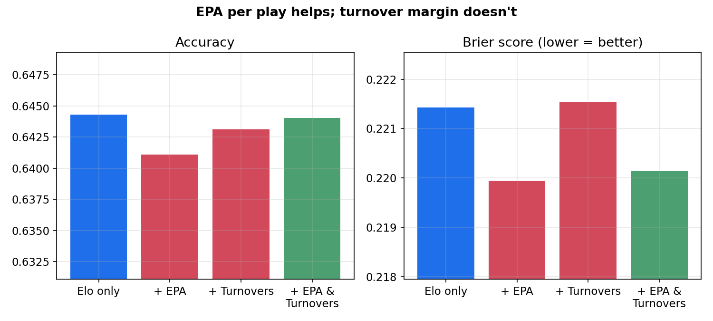
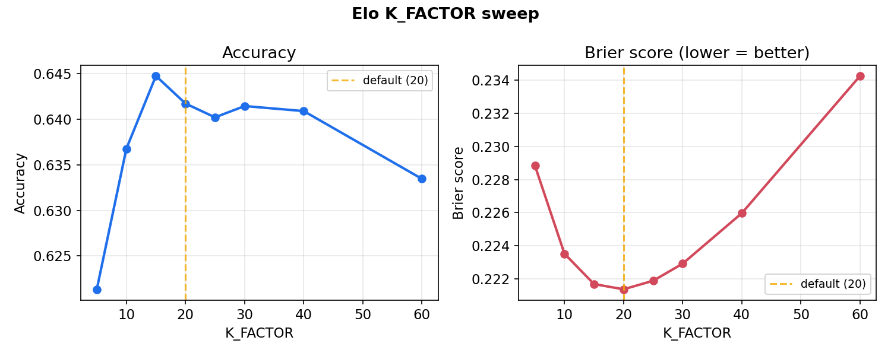
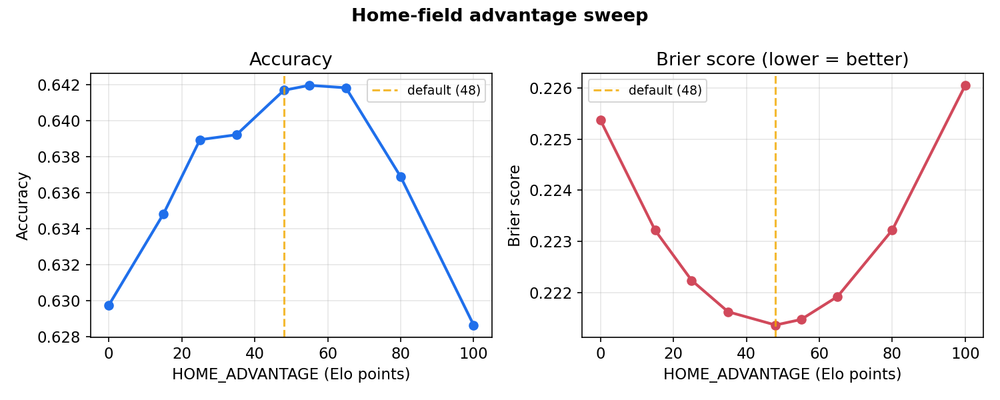
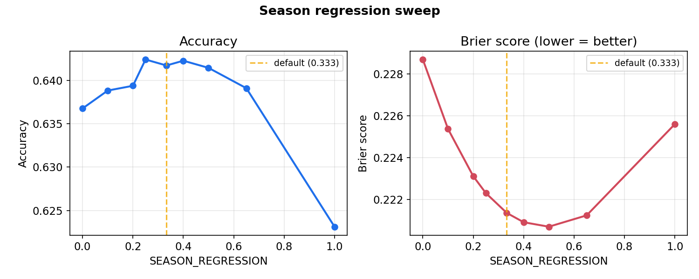
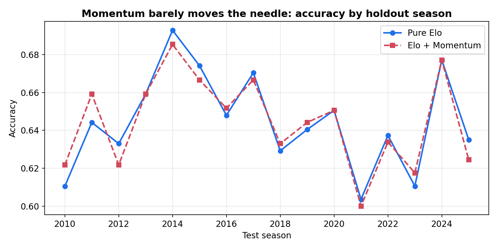

# NFL Game Prediction Model

An Elo-based NFL game predictor, benchmarked against Vegas closing lines and extended with
a series of feature-engineering experiments (scoring momentum, EPA per play, turnover
margin) — each one tested with a leakage-free, season-based holdout methodology, including
two honest null results and the reasoning behind why they didn't pan out.

## Key results

| Metric | Value |
|---|---|
| Elo model accuracy (picking the winner) | **64.2%** |
| Vegas favorite accuracy, same games | 66.4% |
| Elo Brier score (calibration; 0.25 = coin flip) | 0.221 |
| Best feature addition found | EPA per play (**+0.7%** Brier improvement) |
| Games backtested | 7,276 (1999–2025 seasons) |



Landing about 2 points behind Vegas — which prices in injury reports, weather, and sharp
betting action a pure Elo model has no access to — is a strong result for a model built
entirely from final scores.

*Backtest figures cover fully-played seasons (1999–2025). The 2026 season is in progress,
so it's excluded from evaluation to keep results reproducible — but `predict_week.py` does
use every 2026 game played so far when building live ratings.*

## What this project does

1. Pulls 27+ seasons of NFL game results and play-by-play data from the public
   [nflverse](https://github.com/nflverse) dataset.
2. Builds an Elo rating system tuned specifically for the NFL (home-field advantage,
   margin-of-victory weighting, season-to-season regression).
3. Backtests it against real historical outcomes and Vegas closing lines to measure
   genuine predictive skill, not just curve-fitting.
4. Tests whether additional features — recent scoring momentum, offensive/defensive EPA
   per play, turnover margin — actually improve the model, using a methodology designed to
   catch data leakage before it inflates the results.
5. Outputs a script you rerun weekly to get predictions for the upcoming slate of games.

## Key findings

| Experiment | Result | Why |
|---|---|---|
| **Hyperparameter tuning** (K-factor, home advantage, season regression) | All three showed a clear sweet spot in the middle of a U-shaped curve | Too reactive = chases noise; too stable = can't adapt to real change |
| **Recent scoring momentum** | No improvement (redundant) | Elo already absorbs recent form through its own update mechanism — momentum carried no *new* information |
| **EPA per play** | Real improvement (+0.7% Brier) | Measures play-by-play efficiency — a process signal Elo is structurally blind to |
| **Turnover margin** | No improvement (too noisy) | Turnovers are heavily luck-driven game to game and don't persist as a predictive signal the way efficiency metrics do |

Full methodology, numbers, and reasoning for each experiment are in the
[Full experiment log](#full-experiment-log) below.

## How it works

The core model is an [Elo rating system](https://en.wikipedia.org/wiki/Elo_rating_system) —
the same family of algorithm used for chess rankings. Every team starts at 1500. Before each
game, the rating gap between the two teams (plus a home-field bonus) produces a win
probability. After the game, both ratings shift based on how surprising the result was:
beating a team you were heavily favored against barely moves your rating; upsetting a much
stronger opponent moves it a lot. Blowouts also move ratings more than close wins, via a
margin-of-victory multiplier.

On top of that baseline, this project tests whether a logistic regression using additional
features (beyond what Elo can see) can do better — see [Key findings](#key-findings) above.

## Quickstart

```bash
# 1. Install dependencies
pip install -r requirements.txt

# 2. Only needed for the EPA / turnover experiment (fetch_pbp.py).
#    nfl_data_py pins an old pandas/numpy that won't build on modern Python,
#    so install it on its own, skipping its pinned dependencies:
pip install nfl_data_py --no-deps

# 3. Get predictions for the next unplayed week + current power rankings
python predict_week.py --rankings

# 4. Check model accuracy against 27 years of history and Vegas lines
python backtest.py
```

Run all scripts from the project root folder — they use relative paths like `data/`.
Cached data files are created automatically on first run.

## Project structure

**Core model**
- `data.py` — downloads/cleans game results; normalizes relocated franchises (Rams,
  Chargers, Raiders) so rating history carries through the move; falls back to fetching
  fresh data if no cache exists yet
- `elo.py` — the Elo rating system: updates, home-field advantage, margin-of-victory
- `predict_week.py` — **the script you run each week** for live predictions
- `backtest.py` — validates the model against 1999–2025 history and Vegas lines

**Hyperparameter tuning**
- `sweep_utils.py`, `k_sweep.py`, `home_advantage_sweep.py`, `season_regression_sweep.py`

**Feature experiments**
- `momentum.py`, `build_features.py`, `train_model.py` — scoring momentum experiment
- `fetch_pbp.py`, `aggregate_pbp.py`, `build_epa_features.py`, `train_epa_model.py` — EPA /
  turnover margin experiment (run `fetch_pbp.py` first)

**Utilities**
- `make_charts.py` — regenerates the PNGs in `images/` used by this README
- `requirements.txt`, `.gitignore`

## Methodology notes worth knowing

- **No lookahead leakage.** Every feature used to predict a game reflects only information
  available *before* that game was played. Trackers are read, then updated — never the
  other way around.
- **Season-based train/test splits**, not random row splits. Models are trained only on
  seasons strictly before the test season, since a random split would let a model trained on
  Week 10 of a season "see the future" relative to Week 3 of that same season.
- **Every holdout claim is averaged across many seasons** (16, for the feature experiments),
  not just one — a single season's result is noisy enough to be misleading on its own.
- **Only fully-played seasons are used for evaluation**, so a season still in progress
  can't skew the averages.
- **Accuracy and Brier score are both reported, deliberately.** They occasionally disagree
  (see the momentum experiment below), and Brier score — which rewards well-calibrated
  confidence, not just picking the right side of 50% — is generally the more trustworthy
  signal of the two.

## Where to go from here

1. **Track live predictions** — log each week's picks and score them against real results
   as the 2026 season plays out. The real test of whether this works.
2. **Rest days & travel distance** — already sitting in the raw dataset, unused so far.
3. **Turnover *rates* instead of raw counts** — might strip out some of the recovery-luck
   noise that sank raw turnover margin as a feature.
4. **A real ML model (XGBoost)** on top of the features already built, to capture nonlinear
   interactions a logistic regression can't.
5. **Predict the spread, not just the winner** — a regression model on point differential
   would compare more directly against Vegas spreads.
6. **Automate the weekly run** via cron or GitHub Actions.

---

## Full experiment log

### Hyperparameter sweeps

Rather than guess at good values for the Elo constants in `elo.py`, we swept each one
individually against the full 1999–2025 backtest (holding the others at default) to see
which values actually minimize error.

**General pattern across all three parameters:** performance is a smooth curve with a
sweet spot in the middle, not a "more/less is always better" relationship. Too low and the
model can't adapt to real changes in team strength; too high and it overreacts to noise
(one fluky blowout, one weird season).

#### K_FACTOR (how much one game moves a team's rating)

| K  | Accuracy | Brier |
|----|----------|-------|
| 5  | 0.6214   | 0.2288 |
| 10 | 0.6368   | 0.2235 |
| 15 | **0.6447** | 0.2217 |
| 20 (default) | 0.6417 | **0.2214** |
| 25 | 0.6402   | 0.2219 |
| 30 | 0.6414   | 0.2229 |
| 40 | 0.6409   | 0.2260 |
| 60 | 0.6335   | 0.2343 |

Sweet spot: 15-25. Our default of 20 is close to optimal on both metrics; K=15 edges it out
slightly on raw accuracy, K=20 is marginally better on calibration (Brier). The two are
close enough to be within noise. K=60 clearly overfits to single-game noise (both metrics
get meaningfully worse).



#### HOME_ADVANTAGE (Elo points added to home team before computing win probability)

| Value | Accuracy | Brier |
|-------|----------|-------|
| 0   | 0.6297   | 0.2254 |
| 15  | 0.6348   | 0.2232 |
| 25  | 0.6390   | 0.2222 |
| 35  | 0.6392   | 0.2216 |
| 48 (default) | 0.6417 | **0.2214** |
| 55  | **0.6420** | 0.2215 |
| 65  | 0.6418   | 0.2219 |
| 80  | 0.6369   | 0.2232 |
| 100 | 0.6286   | 0.2261 |

Sweet spot: 48-55. Our default of 48 sits right at the Brier-optimal point. Confirms real
NFL home-field advantage is worth roughly this many Elo points — consistent with commonly
cited estimates (~48-55 points, or a bit less than 3 points of scoring margin).



#### SEASON_REGRESSION (fraction each rating reverts toward 1500 between seasons)

| Value | Accuracy | Brier |
|-------|----------|-------|
| 0.00 (no regression) | 0.6368 | 0.2287 |
| 0.10 | 0.6388 | 0.2254 |
| 0.20 | 0.6394 | 0.2231 |
| 0.25 | 0.6424 | 0.2223 |
| 0.333 (default) | 0.6417 | 0.2214 |
| 0.40 | **0.6422** | 0.2209 |
| 0.50 | 0.6414 | **0.2207** |
| 0.65 | 0.6391 | 0.2213 |
| 1.00 (full reset) | 0.6231 | 0.2256 |

Sweet spot: 0.25-0.5, flatter/more forgiving than the other two params — the model isn't
very sensitive to this one within that range. Full reset to 1500 every season (1.0) is
clearly the worst option: it throws away real signal about team quality that persists
year to year. No regression at all (0.0) is also suboptimal — rosters and coaching do
change enough between seasons that some reversion toward the mean is warranted.



**Caveat:** these are one-at-a-time sweeps (only one parameter varied per run, others held
at default). They don't test interaction effects — e.g. the best HOME_ADVANTAGE might
shift slightly if K_FACTOR were also changed from default. A full grid search across all
three simultaneously would be the more rigorous next step if squeezing out the last bit of
accuracy matters.

### Feature engineering experiments

#### Recent scoring momentum (added on top of Elo)

**Files:** `momentum.py` (rolling point-differential tracker), `build_features.py`
(builds a leakage-free feature table), `train_model.py` (logistic regression on
`[elo_prob_home, momentum_diff]`, evaluated with a season-based train/test split).

**Methodology note:** this was the first model that's actually *fit* to data (Elo just
updates online, no separate training step), so it needed a proper train/test split to
avoid leakage. We split by SEASON, not by row — training only on seasons strictly before
the test season, and testing across 16 different holdout seasons (2010-2025) rather than
just one, since any single season's result is noisy on its own.

**Result: momentum was redundant, not harmful.**

| Metric | Elo + Momentum | Pure Elo |
|--------|---------------|----------|
| Accuracy (avg across 16 holdout seasons) | 0.6446 | 0.6448 |
| Brier score (avg) | 0.2204 | 0.2213 |

The two metrics point in slightly different directions, which is worth being precise about
rather than summarizing as one-sided:
- **Accuracy** is technically 0.02pp worse with momentum — but that's about 1 game out of
  ~4,500 test games. That's noise, not a real effect; a different momentum window or a
  different set of holdout seasons could easily flip that sign.
- **Brier score** is *better* with momentum, by about 0.4% relative. Small, but in the
  right direction, and arguably the more informative metric since it captures calibration
  rather than just which side of 50% you landed on.

So the honest conclusion isn't "momentum hurts the model" — a genuinely harmful feature
would actively confuse the model or degrade performance. What actually happened is closer
to **the feature carried ~zero marginal information**, and the model correctly learned to
almost ignore it: the fitted logistic regression put nearly all its weight on Elo
(coefficient ~3.03) and almost none on momentum (~0.018). A feature with zero information
content isn't dangerous to include, just pointless complexity for no benefit — which is
itself a fine enough reason to leave it out.

**Why it didn't help:** Elo already captures recent form, because it updates after every
single game based on the actual result. A team on a hot streak already has a rising Elo
rating by the time you'd separately compute their "momentum" — so momentum_diff is mostly
redundant with information Elo already has, not new information. This is a useful general
lesson: a feature only helps a model if it captures something the model doesn't already
know, not just something correlated with the outcome.



#### EPA per play & turnover margin (from play-by-play data)

**Files:** `fetch_pbp.py` (downloads and caches play-by-play data from nflverse),
`aggregate_pbp.py` (aggregates raw plays into per-team-per-game offensive/defensive EPA
and turnover counts), `build_epa_features.py` (turns those into leakage-free pre-game
rolling averages, same pattern as momentum.py), `train_epa_model.py` (compares four
feature sets against pure Elo, same season-holdout methodology as the momentum experiment).

**Result: EPA per play helps; turnover margin doesn't.**

| Feature set | Accuracy (avg) | Brier (avg) |
|---|---|---|
| Elo only | 0.6443 | 0.2214 |
| Elo + EPA | 0.6411 | **0.2199** |
| Elo + turnover margin | 0.6431 | 0.2215 |
| Elo + EPA + turnover margin | 0.6440 | 0.2201 |

EPA per play (offense and defense, each averaged over the team's last 5 games) improves
Brier score by ~0.7% relative — a bigger improvement than momentum managed. Accuracy dips
slightly, but as with momentum, Brier is the more trustworthy metric here.

Turnover margin, on the other hand, does essentially nothing — Brier is flat to very
slightly worse, accuracy likewise. Combining both features roughly nets out to EPA's gain
minus turnovers' small drag.

**Why EPA and turnover margin behave so differently, even though both come from the same
play-by-play data:** this is a different failure mode than momentum's redundancy problem.
EPA per play measures the underlying *process* of how efficiently a team moves the ball on
a given play — offensive/defensive skill that tends to persist game to game. Turnover
margin, by contrast, is heavily influenced by randomness: a tipped pass landing in a
defender's hands, a fumble bouncing the recovering team's way. This lines up with a
well-known finding in football analytics — turnovers don't persist as a predictive signal
nearly as reliably as efficiency metrics do, because a lot of what drives them from game to
game is luck, not repeatable team quality. So the lesson here is distinct from momentum's:
that failed because it was *redundant* with what Elo already knew; turnover margin fails
because the underlying signal is *inherently noisy*, not because Elo already captured it.

**Practical implication:** if refining this further, EPA per play is worth keeping and
could be layered in as a permanent addition to the model. Raw turnover margin, as computed
here, is not — though a more sophisticated version (e.g. expected turnovers based on
fumble/interception RATES rather than raw counts, which strips out some of the
recovery-luck noise) might behave differently and would be worth testing before writing off
turnovers as a feature entirely.
